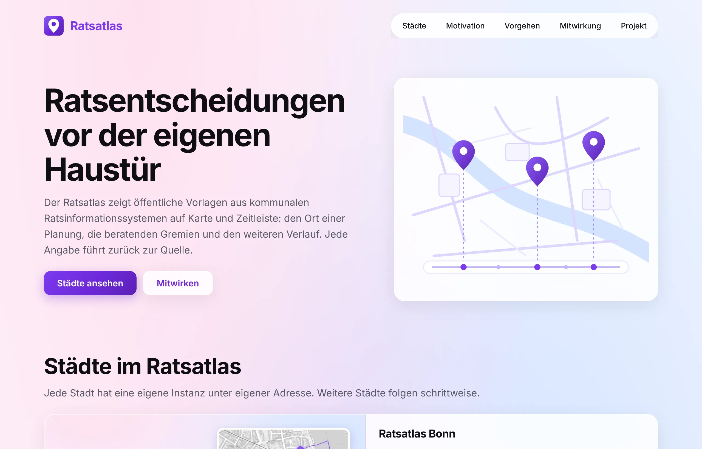
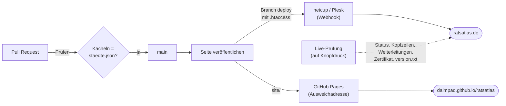

# Ratsatlas

**Öffentliche Vorlagen aus kommunalen Ratsinformationssystemen – räumlich, zeitlich und nach Gremien und Ämtern erschlossen.**

[ratsatlas.de](https://ratsatlas.de) · [Technik](TECHNIK.md) · [Prüfprotokoll](pruefung.tsv)

 

## Worum es geht

Der Ratsatlas erschließt öffentliche Vorlagen aus kommunalen Ratsinformationssystemen räumlich, zeitlich und nach beteiligten Gremien und Ämtern. Jede Angabe ist auf ihre Quelle im Ratsinformationssystem rückführbar; abgeleitete Informationen sind gekennzeichnet.

Dieses Repository ist der **gemeinsame Kern**: Es trägt die Startseite [ratsatlas.de](https://ratsatlas.de) und die Gestaltungsgrößen (`site/tokens.css`), Schrift und Symbole, die die Stadtinstanzen übernehmen. Jede Stadt läuft unter einer eigenen Subdomain aus einem eigenen Repository.

## Städte

| Stadt | Adresse | Datenquelle | Repository | Status |
|---|---|---|---|---|
| Bonn | [bonn.ratsatlas.de](https://bonn.ratsatlas.de) | OParl-Schnittstelle der Stadt Bonn | [daimpad/allris-test](https://github.com/daimpad/allris-test) |  |
| Köln | koeln.ratsatlas.de | OParl-Schnittstelle der Stadt Köln | offen |  |

## Vom Commit zur Seite

Jede Änderung durchläuft dieselben Stationen. Die Badges oben zeigen den aktuellen Zustand jeder Station.

| Workflow | Wann | Was er prüft oder tut |
|---|---|---|
| **Prüfen** | jeder Pull Request | Kacheln und JSON-LD in `site/index.html` entsprechen `staedte.json` |
| **Seite veröffentlichen** | jeder Push auf `main` | prüft erneut, schreibt `site/` als Branch `deploy` für das Webhosting und liefert an GitHub Pages aus |
| **Live-Prüfung** | auf Knopfdruck | Status 200, fünf Sicherheitskopfzeilen, Weiterleitungen von `http` und `www`, eigene 404-Seite, Zertifikat und ob `ratsatlas.de/version.txt` dem Branch `deploy` entspricht |

## Eine Stadt hinzufügen

1. Eintrag in [`staedte.json`](staedte.json) ergänzen – Status `in Vorbereitung` ergibt eine Kachel ohne Link, `online` eine verlinkte Kachel.
2. `python3 scripts/kacheln.py` ausführen; das Skript schreibt Kacheln und JSON-LD in `site/index.html`.
3. Pull Request öffnen – „Prüfen“ stellt sicher, dass HTML und Liste übereinstimmen.

## Grundsätze

- **Ohne Tracking und ohne fremde Server:** keine Cookies, keine Reichweitenmessung, keine CDN; auch die Schrift liegt auf dem eigenen Server.
- **Barrierearm:** axe-core ohne Verstöße bei 360, 768 und 1280 px, Kontraste nachgerechnet, vollständig per Tastatur bedienbar, Rücksicht auf reduzierte Bewegung.
- **Klein:** rund 65 KB ohne Vorschaubild, kein JavaScript, kein Build-Werkzeug.
- **Nachvollziehbar:** jede Prüfung mit Werkzeug, Erwartung und Ergebnis in [`pruefung.tsv`](pruefung.tsv).

Aufbau, Sicherheitskopfzeilen, Deployment und Prüfwerkzeuge im Einzelnen: **[TECHNIK.md](TECHNIK.md)**.

## Lizenzen

Code unter [MIT](LICENSE) · Schrift Inter unter [SIL Open Font License 1.1](site/fonts/LICENSE-Inter.txt) · [Impressum](https://nozilla.de/impressum/) · [Datenschutz](https://ratsatlas.de/datenschutz.html)
